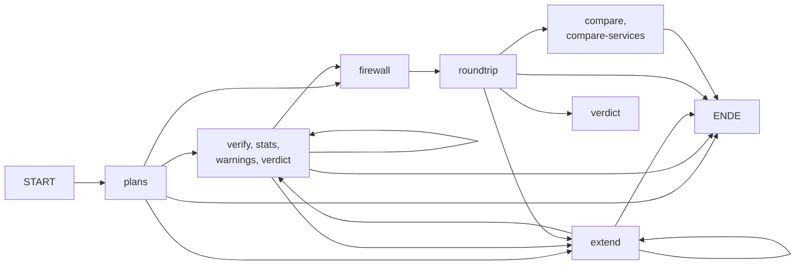

# sbntgg

**sbntgg** ist die Implementierung des **Subnetz Algorithmus** (Paket und Kommandozeilenprogramm `subnetplan`, Version 4.0.0). Er teilt einen zugewiesenen IPv4- oder IPv6-Adressbereich automatisch in überlappungsfreie Subnetze für Mitarbeiter- und Ressourcengruppen auf (inklusive VLAN-IDs, Gateways und Wachstumsreserve) und erzeugt aus der Zugriffsmatrix optional Firewall-Regeln für iptables, nftables und Cisco-ACLs.

[](https://www.python.org/)
[](tests/)
[](doc/coverage/index.html)
[](doc/coverage/index.html)

## Inhaltsverzeichnis

- [Überblick](#überblick)
- [Der Subnetz Algorithmus](#der-subnetz-algorithmus)
- [Schnellstart](#schnellstart)
- [Konfiguration](#konfiguration)
- [Beispielkonfiguration](#beispielkonfiguration)
- [Berechnungsregeln](#berechnungsregeln)
- [Ausgabe](#ausgabe)
- [Firewall-Regeln](#firewall-regeln)
- [Protokolle und Ports](#protokolle-und-ports)
- [Projektstruktur](#projektstruktur)
- [Voraussetzungen](#voraussetzungen)
- [Installation](#installation)
- [JSON API](#json-api)
- [Sequenzprüfung](#sequenzprüfung)
- [Funktionen](#funktionen)
- [Experimente](#experimente)
- [Tests](#tests)
- [Wissenschaftliche Arbeit](#wissenschaftliche-arbeit)
- [Erwerb](#erwerb)

## Überblick

`subnetplan` teilt einen zugewiesenen IP-Bereich (IPv4 oder IPv6) automatisch in Subnetze für Mitarbeiter- und Ressourcengruppen auf. Jede Gruppe erhält ein eigenes Subnetz mit VLAN-ID, Gateway und Wachstumsreserve. Aus der Zugriffsmatrix (`access`) lassen sich optional Firewall-Regeln für iptables, nftables oder Cisco-ACLs erzeugen.

## Der Subnetz Algorithmus

Der Subnetz Algorithmus ist ein deterministischer Algorithmus zur Planung von IP-Netzen. Er ordnet die Gruppen nach absteigender Blockgröße (bei gleicher Größe nach `priority`, dann nach der Reihenfolge in der Datei) und legt die Blöcke lückenlos ab der Startadresse des Basisnetzes ab. Die Arbeit `science/sbntgg.tex` beweist unter anderem:

- **Korrektheit:** Alle Subnetze sind ausgerichtet, paarweise überlappungsfrei, liegen im Basisnetz und fassen den Bedarf der Gruppe.
- **Optimalität:** Die Sortierung „größte Blöcke zuerst“ ist lückenlos und unter allen Anordnungen optimal; passt irgendeine Anordnung ins Basisnetz, passt auch diese.
- **Freie Bereiche:** Der Rest ist exakt als Binärdarstellung beschrieben; Wachstumsreserven lassen sich ohne Umnummerierung nutzen, sobald ihre Gesamtgröße in den freien Adressraum passt.
- **Firewall:** Die erzeugten Regeln erlauben genau die in `access` freigegebenen Paare (Default-Deny).
- **Laufzeit:** Der Kern braucht Θ(n log n) im Vergleichsmodell, die gesamte Planung O(n² + a) (n Gruppen, a Einträge in allen `access`-Listen).

Der Subnetz Algorithmus ist nicht der Subgraph Algorithmus. Dieser ist ein eigenständiges Verfahren (https://github.com/naphets86/subgraph) und wird hier nur für den Richtlinienvergleich (`--compare`) als Abhängigkeit verwendet.

## Schnellstart

```bash
python -m venv .venv && source .venv/bin/activate   # Windows: .venv\Scripts\activate
pip install -e ".[dev]"
subnetplan examples/config.example.yaml
```

Ohne Installation funktioniert auch `python -m src.cli examples/config.example.yaml`.

```bash
subnetplan examples/config.example.yaml --format json -o plan.json
subnetplan examples/config.example.yaml --format csv -o plan.csv
subnetplan examples/config.example.yaml --firewall nftables --firewall-output rules.nft
subnetplan examples/config.example.yaml --base-network 192.168.0.0/16 --strategy fixed
```

Mit `--format json` oder `--format csv` zusammen mit `--firewall` muss `--output` oder `--firewall-output` angegeben werden, damit die Standardausgabe maschinenlesbar bleibt.

## Konfiguration

Die Konfiguration ist eine YAML- oder JSON-Datei. Ein vollständiges Beispiel mit Erklärung steht im Abschnitt [Beispielkonfiguration](#beispielkonfiguration).

| Schlüssel | Bedeutung | Standard |
| --- | --- | --- |
| `base_network` | zugewiesener Bereich, zum Beispiel `10.20.0.0/16` | Pflicht |
| `growth_factor` | Wachstumsreserve je Gruppe, mindestens `1.0` | `1.25` |
| `allocation_strategy` | `vlsm` oder `fixed` | `vlsm` |
| `gateway_position` | `first`, `last` oder `none` | `first` |
| `groups` | Liste der Gruppen | Pflicht |
| `max_prefix` | längste erlaubte Präfixlänge (Mindestblockgröße), zum Beispiel `64` bei IPv6 | keine Grenze |
| `pools` | zusätzliche Netze neben `base_network` (gleiche IP-Version) | keine |
| `existing` | bereits belegte Netze, die im Plan ausgespart werden (gleiche IP-Version) | keine |

Je Gruppe: `name` und `hosts` sind Pflicht, `vlan_id`, `priority` und `access` sind optional. Weitere optionale Gruppenschlüssel sind `overhead` (eigener Adressoverhead), `network` (festes Netz) und `site` (Standort für die zweistufige Planung; entweder für alle Gruppen oder für keine). Die Optionen `--base-network`, `--growth-factor`, `--strategy`, `--gateway` und `--max-prefix` überschreiben die Datei.

Gruppennamen dürfen nur Buchstaben, Ziffern, `_`, `-` und Leerzeichen enthalten, weil sie in Regelkommentaren und ACL-Namen landen.

## Beispielkonfiguration

Der Ordner `examples/` enthält mit `config.example.yaml` eine vollständige, sofort lauffähige Konfiguration für ein fiktives Firmennetz. Die Datei hat drei Aufgaben:

- **Vorlage:** Du kopierst sie und ersetzt Basisnetz und Gruppen durch die eigenen.
- **Referenz:** Sie verwendet jeden Konfigurationsschlüssel mindestens einmal und zeigt damit, wie die Schlüssel zusammenspielen.
- **Testgrundlage:** Der Test `test_example_configuration_is_valid` in `tests/test_cli.py` lädt die Datei, berechnet daraus einen Plan und prüft, dass fünf Subnetze entstehen und die Gruppe `Server` die VLAN-ID 100 erhält. Ändert sich später die Validierung, fällt eine veraltete Beispieldatei dadurch sofort auf.

### Inhalt der Datei

```yaml
# Beispielkonfiguration für subnetplan
base_network: 10.20.0.0/16      # zugewiesener Bereich (IPv4 oder IPv6)
growth_factor: 1.25             # Wachstumsreserve pro Gruppe (>= 1.0)
allocation_strategy: vlsm       # vlsm = größte Gruppe zuerst | fixed = einheitliche Präfixlänge
gateway_position: first         # first | last | none

groups:
  - name: Server
    hosts: 40
    vlan_id: 100
    priority: 0                 # kleinere Zahl = früher im Adressraum (bei gleicher Größe bzw. bei fixed)
    access: [Drucker]

  - name: Entwicklung
    hosts: 120
    access: [Server, Drucker]

  - name: HR
    hosts: 25
    access: [Drucker]

  - name: Drucker
    hosts: 12

  - name: Gäste
    hosts: 60                   # kein access: keine internen Ziele
```

### Das Szenario

Die Firma hat ein zugewiesenes Netz `10.20.0.0/16` und fünf Gruppen mit unterschiedlichen Rechten:

| Gruppe | Hosts | darf zugreifen auf | Besonderheit |
| --- | --- | --- | --- |
| `Server` | 40 | `Drucker` | feste `vlan_id: 100`, ausdrücklich `priority: 0` |
| `Entwicklung` | 120 | `Server`, `Drucker` | größte Gruppe, zwei Zugriffsziele |
| `HR` | 25 | `Drucker` | |
| `Drucker` | 12 | niemanden | reiner Dienst, löst selbst keine Verbindungen aus |
| `Gäste` | 60 | niemanden | kein `access`, also kein Zugriff auf interne Netze |

Damit zeigt die Datei die wichtigsten Fälle: eine explizit gesetzte VLAN-ID neben automatisch vergebenen, Gruppen mit mehreren, einem und keinem Zugriffsziel sowie die Felder `priority` und `access`. Die Kopfschlüssel `growth_factor`, `allocation_strategy` und `gateway_position` stehen mit ihren Standardwerten in der Datei, damit man sieht, was sich ändern lässt. `base_network` ist als Einziger ein Pflichtfeld ohne Standardwert.

### Was daraus berechnet wird

Der Aufruf

```bash
subnetplan examples/config.example.yaml
```

rechnet zuerst den Bedarf je Gruppe aus (Hosts mal 1,25, aufgerundet, plus Netzadresse, Broadcast und Gateway) und wählt die kleinste Präfixlänge, die diesen Bedarf fasst:

| Gruppe | Rechnung | Adressen | Präfix |
| --- | --- | --- | --- |
| `Entwicklung` | 120 × 1,25 = 150, plus 3 | 153 | `/24` (256) |
| `Gäste` | 60 × 1,25 = 75, plus 3 | 78 | `/25` (128) |
| `Server` | 40 × 1,25 = 50, plus 3 | 53 | `/26` (64) |
| `HR` | 25 × 1,25 = 31,25, aufgerundet 32, plus 3 | 35 | `/26` (64) |
| `Drucker` | 12 × 1,25 = 15, plus 3 | 18 | `/27` (32) |

Daraus entsteht dieser Plan (Auszug der Tabellenspalten):

| Gruppe | VLAN | Netz/CIDR | Gateway | Host-Range | Nutzbar | Bedarf |
| --- | --- | --- | --- | --- | --- | --- |
| `Entwicklung` | 10 | `10.20.0.0/24` | `10.20.0.1` | `10.20.0.2 - 10.20.0.254` | 253 | 120 |
| `Gäste` | 40 | `10.20.1.0/25` | `10.20.1.1` | `10.20.1.2 - 10.20.1.126` | 125 | 60 |
| `Server` | 100 | `10.20.1.128/26` | `10.20.1.129` | `10.20.1.130 - 10.20.1.190` | 61 | 40 |
| `HR` | 20 | `10.20.1.192/26` | `10.20.1.193` | `10.20.1.194 - 10.20.1.254` | 61 | 25 |
| `Drucker` | 30 | `10.20.2.0/27` | `10.20.2.1` | `10.20.2.2 - 10.20.2.30` | 29 | 12 |

Belegt sind 544 von 65.536 Adressen (0,83 %). Die 64.992 freien Adressen stehen als zehn zusammengefasste Restbereiche zur Verfügung, von `10.20.2.32/27` bis `10.20.128.0/17`. Dort lassen sich später weitere Gruppen anlegen, ohne bestehende Subnetze zu verschieben.

Drei Punkte erklärt das Beispiel besonders gut:

- **Reihenfolge im Adressraum:** `Gäste` steht in der Datei zuletzt, bekommt aber den zweiten Platz, weil `vlsm` die größten Blöcke zuerst vergibt und ein `/25` größer ist als `/26` und `/27`.
- **Gleiche Größe, gleiche Priorität:** `Server` und `HR` brauchen beide ein `/26` und haben `priority: 0` (bei `HR` der Standardwert). Dann entscheidet die Reihenfolge in der Datei, deshalb liegt `Server` vor `HR`. Setzt du bei `Server` eine größere Zahl als bei `HR` (zum Beispiel `priority: 1`), rückt `HR` nach vorn, denn die kleinere Zahl kommt zuerst.
- **VLAN-IDs:** `Server` behält die feste ID 100. Die übrigen Gruppen erhalten in Dateireihenfolge automatisch 10, 20, 30 und 40, also `Entwicklung` 10, `HR` 20, `Drucker` 30 und `Gäste` 40.

Die Spalte „Nutzbar“ liegt immer über dem Bedarf, weil Subnetzgrößen Zweierpotenzen sind. `Entwicklung` bekommt 253 nutzbare Adressen für 120 Hosts; der Rest ist die eingerechnete Wachstumsreserve.

### Firewall-Regeln aus dem Beispiel

```bash
subnetplan examples/config.example.yaml --firewall nftables --firewall-output rules.nft
```

Aus den `access`-Einträgen ergeben sich genau vier Freigaben: `Entwicklung` zu `Server`, `Entwicklung` zu `Drucker`, `Server` zu `Drucker` und `HR` zu `Drucker`. Der nftables-Teil der Ausgabe sieht so aus:

```text
table inet subnet_acl {
    chain forward {
        type filter hook forward priority 0; policy drop;
        ct state established,related accept
        ip saddr 10.20.0.0/24 ip daddr 10.20.1.128/26 accept comment "Entwicklung -> Server"
        ip saddr 10.20.0.0/24 ip daddr 10.20.2.0/27 accept comment "Entwicklung -> Drucker"
        ip saddr 10.20.1.128/26 ip daddr 10.20.2.0/27 accept comment "Server -> Drucker"
        ip saddr 10.20.1.192/26 ip daddr 10.20.2.0/27 accept comment "HR -> Drucker"
    }
}
```

`Drucker` und `Gäste` tauchen nie als Quelle auf. `Drucker` können Antworten auf Anfragen schicken (`ct state established,related`), aber keine eigenen Verbindungen in andere Netze aufbauen. `Gäste` erreichen keines der internen Netze.

Wichtig: Die erzeugten Regeln verwerfen alles, was nicht ausdrücklich freigegeben ist, also auch die Weiterleitung ins Internet. Brauchen `Gäste` Internetzugang, muss er zusätzlich im Regelwerk ergänzt werden.

Mit `--firewall iptables` entstehen dieselben vier Freigaben als `iptables`-Befehle in der Kette `SUBNET_ACL`. Mit `--firewall cisco` erhält jede Gruppe eine eigene eingehende ACL, zum Beispiel `ACL-100-SERVER` für `Server` am Interface `Vlan100`. Die ACL von `Gäste` (`ACL-40-GÄSTE`) enthält nur `deny ip any any`.

### Varianten ausprobieren

Die Beispieldatei lässt sich mit Kommandozeilenoptionen abwandeln, ohne sie zu bearbeiten:

```bash
# Alle Gruppen bekommen die Größe der größten Gruppe: fünf Netze 10.20.0.0/24 bis 10.20.4.0/24
subnetplan examples/config.example.yaml --strategy fixed

# Dasselbe Beispiel in einem anderen Adressbereich
subnetplan examples/config.example.yaml --base-network 192.168.0.0/16

# Ohne Wachstumsreserve und ohne Gateway-Adresse: kleinere Subnetze
subnetplan examples/config.example.yaml --growth-factor 1.0 --gateway none

# Maschinenlesbar weiterverarbeiten
subnetplan examples/config.example.yaml --format json -o plan.json
```

Bei `--strategy fixed` richtet sich die Reihenfolge nach `priority` und danach nach der Datei. Im Beispiel bekommt `Server` deshalb `10.20.0.0/24`, gefolgt von `Entwicklung`, `HR`, `Drucker` und `Gäste`.

### Eigene Konfiguration ableiten

1. Datei kopieren, zum Beispiel `cp examples/config.example.yaml mein-netz.yaml`.
2. `base_network` auf den zugewiesenen Bereich setzen.
3. Unter `groups` die eigenen Gruppen mit `name` und `hosts` eintragen, bei Bedarf `vlan_id` und `priority` ergänzen.
4. In `access` festlegen, welche Gruppen welche anderen erreichen dürfen. Die Namen müssen genau einer Gruppe in der Datei entsprechen.
5. `subnetplan mein-netz.yaml` ausführen. Tippfehler bei Schlüsseln, doppelte Namen oder VLAN-IDs, unbekannte Gruppen in `access` und zu wenig Platz im Basisnetz werden mit einer Fehlermeldung gemeldet, ohne dass ein Plan ausgegeben wird.

## Berechnungsregeln

- Bedarf je Gruppe: `ceil(hosts * growth_factor)` plus Netzadresse, Broadcast (nur IPv4) und Gateway (außer bei `gateway_position: none`). Das Subnetz erhält die kleinste Präfixlänge, die diesen Bedarf fasst.
- `vlsm`: größte Blöcke zuerst, bei gleicher Größe entscheidet `priority` (kleinere Zahl zuerst), danach die Reihenfolge in der Konfiguration.
- `fixed`: alle Gruppen erhalten die Präfixlänge der größten Gruppe, die Reihenfolge folgt `priority` und danach der Konfiguration.
- Fehlt `vlan_id`, wird automatisch vergeben (10, 20, 30, ...), ohne Kollision mit expliziten IDs.
- Reicht das Basisnetz nicht aus, bricht `subnetplan` mit einer Meldung zum Platzmangel ab.

## Ausgabe

Tabelle (Standard), CSV oder JSON mit Gruppe, VLAN, Netz/CIDR, Subnetzmaske, Gateway, Host-Range, Broadcast, nutzbaren Hosts und angefordertem Bedarf. Dazu kommen Belegung des Basisnetzes und die freien Restbereiche.

## Firewall-Regeln

Alles, was nicht in `access` freigegeben ist, wird verworfen. Zugriff auf das eigene Subnetz braucht keine Regel.

| System | Ausgabe |
| --- | --- |
| `iptables` | eigene Kette `SUBNET_ACL` (zustandsbehaftet), eingehängt in `FORWARD`; `ip6tables` bei IPv6 |
| `nftables` | Tabelle `inet subnet_acl` mit Policy `drop`, zustandsbehaftet |
| `cisco` | je Gruppe eine eingehende Extended-ACL am Interface `Vlan<ID>` |

Cisco-ACLs sind zustandslos, Rückverkehr braucht passende Gegenregeln. Die erzeugten Regeln sind ein Ausgangspunkt und sollten vor dem Einspielen geprüft werden.

## Protokolle und Ports

Ein Eintrag in `access` darf statt des bloßen Gruppennamens ein Mapping `{to: Gruppe, ports: [...]}` sein. Dann gilt die Freigabe nur für die genannten Dienste; ohne `ports` (bloßer Name) bleiben alle Dienste erlaubt, die Regeln sind dann Zeichen für Zeichen die bisherigen.

```yaml
access:
  - to: Server
    ports: [tcp/22, tcp/443, tcp/8000-8099, icmp]
  - Drucker
```

| Angabe | Bedeutung |
| --- | --- |
| `tcp/22`, `udp/5000-5010` | einzelner Zielport beziehungsweise Port-Intervall (1 bis 65535) |
| `tcp`, `udp` | alle Ports des Protokolls |
| `icmp` (IPv4), `icmpv6` (IPv6) | portlose Protokolle |

- Mehrere Einträge für dasselbe Ziel werden vereinigt; ein Eintrag ohne `ports` macht das Ziel unbeschränkt. Überlappende Portangaben ändern nichts, ergeben aber eine Warnung (`--warnings`).
- Port 0 ist reserviert und wird in ausdrücklichen Angaben abgelehnt.
- iptables und Cisco erzeugen je Port-Intervall eine Regel; nftables je Protokoll eine Regel mit Portmenge (`tcp dport { 22, 443, 8000-8099 }`).
- `--group-rules` gruppiert nach Zielmenge *und* Dienstmenge; `--roundtrip` vergleicht zusätzlich die Dienstmenge jedes Paares.
- Bei Cisco mit `--cisco-return established` antwortet der Dienstport (`permit tcp <Ziel> eq 22 <Quelle> established`); Freigaben ohne TCP erzeugen keine Rückverkehrszeile.
- Im Plan-JSON steht `"services": {"Server": ["tcp/22", ...]}` nur bei eingeschränkten Zielen; `--extend` und die Verdopplung erhalten sie.
- `firewall_verdict(plan, quelle, ziel, service="tcp/443")` und `cisco_verdict(..., service=...)` berechnen das Urteil für einen konkreten Dienst; die API-Anfrage `plans/verdict` kennt dafür das Feld `service`. Die Roundtrip-Antwort enthält je Firewall das Feld `service_mismatch` (Paare, deren Dienstmenge im Regeltext abweicht).

Die Mathematik (Normalform, Zerlegung in höchstens 30 Portblöcke, Lücken, Überlappung, Teilmengenprüfung) steht in `src/ports.py`; ein vollständiges Beispiel in `examples/config.ports.example.yaml`.

## Projektstruktur

| Pfad | Inhalt |
| --- | --- |
| `src/models.py` | Konstanten, Datenklassen, `PlanError` |
| `src/config.py` | Laden und Validieren der Konfiguration |
| `src/planner.py` | Bedarfsberechnung, VLAN-Vergabe, Subnetz-Zuteilung |
| `src/render.py` | Ausgabe als Tabelle, CSV und JSON |
| `src/firewall.py` | Regeln für iptables, nftables und Cisco |
| `src/exact.py` | Exakte Bedarfsrechnung `ceil(γ·h)` ohne Gleitkomma |
| `src/blocks.py` | Blockalgebra: freie Bereiche, Packbarkeit (Bedingung (*)), konstruktive Zuteilung |
| `src/access.py` | Zugriffsmatrix, Bereinigung von `access`, Regelgruppierung |
| `src/semantics.py` | Referenzurteile der Regelwerke (Default-Deny, Cisco) |
| `src/hierarchy.py` | Zweistufige Planung mit Standortblöcken (`site`) |
| `src/extend.py` | Plan erweitern (`--extend`), Netze an Ort und Stelle verdoppeln |
| `src/ports.py` | Portmengen, Zerlegung in Portblöcke, Dienstmengen (Kapitel Protokolle und Ports) |
| `src/roundtrip.py` | Regeln zurücklesen und mit der Zugriffsmatrix vergleichen |
| `src/verify.py` | Prüfung eines Plans gegen die Sätze der Arbeit |
| `src/stats.py` | Auslastung, Verschnitt, Poisson-Dimensionierung |
| `src/checks.py` | Warnungen (privater Bereich, VPN-Überschneidung, Auslastung) |
| `src/policy.py` | Richtlinienvergleich, nutzt den Subgraph Algorithmus (Dependency) |
| `src/sequence.py` | Sequenzprüfung: Soll-Graph, zustandsloses Token, Fehler beim Betreten und Verlassen, Verifikation von Spuren (Abschnitt [Sequenzprüfung](#sequenzprüfung)) |
| `src/cli.py` | Kommandozeile |
| `src/experiments.py` | reproduzierbare Experimente (`python -m src.experiments`), nicht Teil der Testabdeckung |
| `src/results/` | Ergebnisse der Experimente als JSON, dazu `summary.json` |
| `web/api.py` | FastAPI-JSON-API (Version 4.0.0) für Planung und Auswertung |
| `tests/` | pytest-Tests, darunter `test_sequence.py` (Sequenzprüfung) und `test_web_sequence.py` (Sequenzprüfung über die API) |
| `science/` | wissenschaftliche Arbeit „Der Subnetz Algorithmus“ (`sbntgg.tex`, `sbntgg.pdf`) |
| `examples/` | Beispielkonfiguration `config.example.yaml` (fünf Gruppen), ausführlich beschrieben im Abschnitt [Beispielkonfiguration](#beispielkonfiguration) |
| `doc/coverage/` | HTML-Bericht der Testabdeckung (wird beim Testlauf erzeugt) |
| `pyproject.toml` | Projektmetadaten (Version 4.0.0) sowie pytest- und Coverage-Konfiguration |

## Voraussetzungen

- Python 3.11 oder neuer
- PyYAML, NumPy, FastAPI und Uvicorn
- Das Paket `subgraph` (Subgraph Algorithmus, https://github.com/naphets86/subgraph, eingebunden als `subgraph @ git+https://github.com/naphets86/subgraph.git`); wird über die `pyproject.toml` per `pip install` eingebunden und nicht kopiert
- Für Tests: `pytest`, `pytest-cov` und `httpx` (wird vom FastAPI-`TestClient` der API-Tests benötigt)

## Installation

```bash
python -m venv .venv
source .venv/bin/activate   # Windows: .venv\Scripts\activate
pip install -e ".[dev]"
```

## JSON API

Die API (Version 4.0.0, identisch mit der Projektversion in der `pyproject.toml`) verarbeitet Konfigurationen als JSON und stellt Planberechnung, Erweiterung, Firewall-Regeln,
Verifikation, Statistiken, Warnungen, Roundtrip-Prüfung, Richtlinienvergleich und Zugriffsurteile bereit.
Sie ist zustandslos: Jede Anfrage enthält ihre Konfiguration, serverseitig wird nichts gespeichert.
Nach der Installation lässt sie sich mit Uvicorn starten:

```bash
uvicorn web.api:app --reload
```

Alternativ startet `subnetplan-api` den Server ohne Reload. Standardmäßig lauscht er auf `127.0.0.1:8000`;
Host und Port können über `SUBNETPLAN_API_HOST` und `SUBNETPLAN_API_PORT` gesetzt werden. Die interaktive
OpenAPI-Dokumentation liegt unter `http://127.0.0.1:8000/docs` und zeigt dort ebenfalls die API-Version 4.0.0.

Planberechnung:

```bash
curl -X POST http://127.0.0.1:8000/api/v1/plans \
  -H "Content-Type: application/json" \
  -d '{"config":{"base_network":"10.20.0.0/16","groups":[{"name":"Server","hosts":40}]}}'
```

### Endpunkte

| Methode und Pfad | Zweck |
| --- | --- |
| `GET /api/v1/health` | Prozessstatus (`{"status":"ok"}`), keine Prüfung externer Abhängigkeiten |
| `GET /api/v1/options` | zulässige Strategien, Gateway-Positionen, Formate, Firewalls und Cisco-Rückverkehrsmodi |
| `POST /api/v1/plans` | Subnetzplan berechnen |
| `POST /api/v1/plans/extend` | bestehenden Plan erweitern, ohne vorhandene Netze zu verschieben |
| `POST /api/v1/plans/verify` | Plan gegen die implementierten Planeigenschaften prüfen |
| `POST /api/v1/plans/stats` | Blockauslastung, Bedarf und internen Verschnitt berechnen |
| `POST /api/v1/plans/warnings` | Hinweise zu Adressbereich, VPN-Überschneidung, Auslastung und Cisco-Besonderheiten |
| `POST /api/v1/plans/firewall` | Regeltext für `iptables`, `nftables` oder `cisco` erzeugen |
| `POST /api/v1/plans/roundtrip` | erzeugte Regeln zurücklesen und mit der Zugriffsmatrix vergleichen |
| `POST /api/v1/plans/compare` | zwei Zugriffspolitiken exakt und mit dem Subgraph Algorithmus vergleichen |
| `POST /api/v1/plans/compare-services` | Freigaben auf Dienstebene (Protokolle und Ports) je Zugriffspaar vergleichen; Relation `equal`, `a_in_b`, `b_in_a` oder `incomparable` |
| `POST /api/v1/plans/verdict` | Urteil `accept` oder `drop` für einen Paketfluss (Quell- und Ziel-IP) |

Die `POST`-Endpunkte erwarten `config` (dieselben Schlüssel wie in der Konfigurationsdatei) und optional `overrides`; `compare` nimmt stattdessen `config_a`, `config_b`, `overrides_a` und `overrides_b`, `extend` zusätzlich den bisherigen `plan`. Fachliche Validierungsfehler
werden mit HTTP 422 als JSON unter `error.type` und `error.message` zurückgegeben; ungültige Feldtypen weist FastAPI ebenfalls mit 422 ab (Schema `detail`). `compare` antwortet mit HTTP 503, wenn der Subgraph Algorithmus nicht verfügbar ist.

Die `POST`-Endpunkte akzeptieren zusätzlich optional die Kopfzeilen `X-Sequence-Start`, `X-Sequence-Token` und `X-Sequence-End`; sie prüfen dann, ob der Request an dieser Stelle einer Folge zulässig ist, und antworten bei einem Verstoß mit HTTP 409 (siehe [Sequenzprüfung](#sequenzprüfung)).

## Sequenzprüfung

Ein einzelner Request an einen einzelnen Endpunkt ist zustandslos: Er hat kein Davor und kein Danach. Ein Prozess ist es nicht.
„Plan berechnen, prüfen, Regeln erzeugen, zurückprüfen, später erweitern“ ist eine **Folge** von Requests, und ihre Reihenfolge hat Bedeutung:

- Erweitert man einen Plan zweimal, hängen die vergebenen Adressen von der Reihenfolge der Erweiterungen ab (zuerst Gruppe G1 oder zuerst Gruppe G3 ergibt zwei verschiedene Pläne mit denselben Gruppen).
- Ein erweiterter Plan ist im Allgemeinen nicht der Plan, den eine Neuplanung derselben Gruppen ergibt (bestehende Netze bleiben bei `extend` gerade unverändert). `verify`, `stats`, `warnings`, `firewall`, `roundtrip` und `verdict` berechnen den Plan aus der Konfiguration **neu**; Regeln, die nach einer Erweiterung aus der Konfiguration erzeugt werden, gehören deshalb nicht zwingend zu dem Plan, den der Client hält.

Die Sequenzprüfung macht diese Reihenfolge prüfbar, **ohne die Zustandslosigkeit der API aufzugeben**. Sie ist **optional**: Wer keine der Kopfzeilen `X-Sequence-*` sendet, erhält das bisherige Verhalten jedes Endpunkts. Die Schemata der Requests ändern sich nicht.

### Zwei Fehler, die es nur bei Folgen gibt

Bei einem einzelnen Endpunkt gibt es nur den Fehler des Requests selbst (422, 503, 413). Eine Folge kann zusätzlich auf zwei Arten verletzt werden, und beide gehen als Fehlermeldung an den Requester:

| Verstoß | Bedeutung | Fehlertyp |
| --- | --- | --- |
| **Unzulässiges Betreten** | Die Folge beginnt mit einem Endpunkt, der kein Einstieg ist (zum Beispiel `extend` ohne vorherigen `plans`-Aufruf) | `sequence/entry_invalid` |
| **Unplanmäßiges Verlassen** | Die Folge weicht vom Soll-Verlauf ab (`sequence/transition_invalid`), endet an einer unzulässigen Stelle (`sequence/end_invalid`) oder wird nach Ablauf der Frist fortgesetzt (`sequence/abandoned_late`) | siehe [Fehlermeldungen](#fehlermeldungen) |

Die Meldung nennt jeweils, **was** passiert ist, **wo** in der Folge der Client steht (letzter gültiger Schritt) und **wie** er weitermachen kann (die zulässigen Nachfolger).

### Funktionsweise

Der Zustand der Folge liegt beim Client, nicht im Server. Jede gültige Antwort enthält ein **Token** in der Kopfzeile `X-Sequence-Token`. Es enthält die Kennung der Folge, die Zahl der bisherigen Schritte, den letzten Endpunkt und die Frist, und es ist mit HMAC-SHA256 signiert. Der Client sendet es im nächsten Request zurück. Der Server prüft die Signatur, die Frist und ob der Übergang `letzter Endpunkt → dieser Endpunkt` im **Soll-Graphen** liegt. Er speichert nichts: Die Prüfung ist eine reine Funktion von (Endpunkt, Kopfzeilen, Uhrzeit), jeder Worker kann jeden Schritt prüfen, und mehrere Folgen beeinflussen sich nicht.

| Kopfzeile | Richtung | Bedeutung |
| --- | --- | --- |
| `X-Sequence-Start` | Request | Kennung der Folge, 1 bis 64 Zeichen aus `A-Z a-z 0-9 . _ -`; nur im ersten Schritt |
| `X-Sequence-Token` | Request | Token aus der Antwort des vorigen Schritts; ab dem zweiten Schritt |
| `X-Sequence-End` | Request | `true` markiert diesen Schritt als letzten der Folge |
| `X-Sequence-Token` | Antwort | Token für den nächsten Schritt; nach dem letzten Schritt gibt es keines mehr |

Die Prüfung läuft vor der Planberechnung und gilt für alle zehn `POST`-Endpunkte (`plans`, `plans/extend`, `plans/verify`, `plans/stats`, `plans/warnings`, `plans/firewall`, `plans/roundtrip`, `plans/compare`, `plans/compare-services`, `plans/verdict`); `GET /health` und `GET /options` gehören nicht zu einer Folge. Die Kopfzeilen erscheinen in der OpenAPI-Dokumentation unter `/docs`.

Schlägt ein Endpunkt selbst fehl (zum Beispiel 422 wegen einer ungültigen Konfiguration), gibt er **kein neues Token** aus: Der Schritt zählt nicht, und das bisherige Token bleibt bis zu seiner Frist gültig, sodass der Client den Schritt korrigiert wiederholen kann.

### Beispiel

```bash
API=http://127.0.0.1:8000/api/v1
CFG='{"base_network":"10.20.0.0/16","groups":[{"name":"Server","hosts":40},{"name":"Buero","hosts":120,"access":["Server"]}]}'
tok() { grep -i '^x-sequence-token:' headers.txt | awk '{print $2}' | tr -d '\r'; }
post() { curl -s -D headers.txt -o out.json -X POST "$API/$1" -H 'Content-Type: application/json' -d "$2" "${@:3}"; }

# 1. Folge beginnen: Plan berechnen (Kennung der Folge im ersten Schritt)
post plans "{\"config\":$CFG}" -H 'X-Sequence-Start: rollout-2026-10'

# 2. Plan prüfen (Token des vorigen Schritts)
post plans/verify "{\"config\":$CFG}" -H "X-Sequence-Token: $(tok)"

# 3. Regeln erzeugen
post plans/firewall "{\"config\":$CFG,\"firewall\":\"nftables\"}" -H "X-Sequence-Token: $(tok)"

# 4. Rückprüfen und die Folge beenden
post plans/roundtrip "{\"config\":$CFG}" -H "X-Sequence-Token: $(tok)" -H 'X-Sequence-End: true'
```

Die Hilfsfunktion `tok` liest das Token des vorigen Schritts aus der zuletzt gespeicherten Antwort, bevor `curl` die Datei neu schreibt. Ohne die Kopfzeilen sind alle vier Aufrufe gewöhnliche Einzelrequests.

### Standard-Soll-Graph

Der Soll-Graph beschreibt die zulässigen Folgen als gerichteten Graphen: Knoten sind die Endpunkte sowie `START` und `ENDE`, Kanten die zulässigen Übergänge. Der Standard bildet den Prozess „planen, prüfen, Regeln erzeugen, zurückprüfen, erweitern“ ab. **Er ist eine Annahme über den Prozess und lässt sich ersetzen** (siehe [Konfiguration](#konfiguration-der-sequenzprüfung)).



Das Diagramm fasst die vier Analyse-Endpunkte zusammen. Maßgeblich sind die Nachfolger je Knoten:

| Nach … | zulässig sind |
| --- | --- |
| `START` | `plans` |
| `plans` | `verify`, `stats`, `warnings`, `verdict`, `firewall`, `extend`, `ENDE` |
| `verify`, `stats`, `warnings`, `verdict` | `verify`, `stats`, `warnings`, `verdict`, `firewall`, `extend`, `ENDE` |
| `firewall` | `roundtrip` |
| `roundtrip` | `verdict`, `extend`, `compare`, `compare-services`, `ENDE` |
| `extend` | `verify`, `stats`, `warnings`, `verdict`, `extend`, `ENDE` |
| `compare`, `compare-services` | `ENDE` |

Was die Einschränkungen ausdrücken:

- **`plans` ist der einzige Einstieg.** Alle anderen Endpunkte setzen einen berechneten Plan voraus.
- **`firewall` folgt nicht auf `extend`.** Die Firewall-Regeln werden aus der Konfiguration neu geplant, nicht aus dem erweiterten Plan; wer Regeln für den erweiterten Plan braucht, muss die vergebenen Netze in die Konfiguration übernehmen (Feld `network` je Gruppe) und eine neue Folge beginnen.
- **`roundtrip` folgt nur auf `firewall`.** Zurückgeprüft wird, was erzeugt wurde.
- **`compare` und `compare-services` beenden die Folge.** Sie vergleichen zwei Konfigurationen und liefern ein Endergebnis.

### Fehlermeldungen

Alle Sequenzfehler haben das Schema `{"status": ..., "error": {"type": ..., "message": ..., ...}}`. Die Statuscodes sind: **409** (Konflikt mit dem Stand der Folge), **422** (die Kennung der Folge ist ungültig) und **503** (die Prüfung ist nicht eingerichtet).

| `error.type` | HTTP | Ursache | zusätzliche Felder | Reaktion des Clients |
| --- | --- | --- | --- | --- |
| `sequence/entry_invalid` | 409 | Betreten mit einem Endpunkt, der kein Einstieg ist | `endpoint`, `allowed_entries` | mit einem zulässigen Einstieg beginnen |
| `sequence/transition_invalid` | 409 | Endpunkt ist kein zulässiger Nachfolger des letzten Schritts | `last_valid_step`, `endpoint`, `expected_next` | einen Endpunkt aus `expected_next` aufrufen oder neu beginnen |
| `sequence/end_invalid` | 409 | `X-Sequence-End: true` an einer Stelle, an der die Folge nicht enden darf | `endpoint`, `expected_next` | Folge fortsetzen |
| `sequence/abandoned_late` | 409 | Folge nach Ablauf der Frist fortgesetzt | `last_valid_step`, `expired_at`, `steps_done` | neue Folge beginnen |
| `sequence/context_invalid` | 409 | Token nicht lesbar, verändert, mit anderem Schlüssel oder aus einer anderen Fassung des Soll-Graphen erzeugt, oder Kennung passt nicht zum Token | – | neue Folge beginnen |
| `sequence/start_invalid` | 422 | Beim Betreten fehlt die Kennung oder sie ist ungültig | – | gültige Kennung senden |
| `sequence/not_configured` | 503 | Kopfzeilen `X-Sequence-*` gesendet, aber `SUBNETPLAN_SEQUENCE_KEY` ist nicht gesetzt | – | Betreiber muss die Prüfung einrichten |

Beispiele (Ausgabe des Moduls `src/sequence.py`):

Betreten ohne Einstieg:

```json
{"status": 409, "error": {"type": "sequence/entry_invalid",
  "message": "Die Folge darf nicht mit 'verify' beginnen",
  "endpoint": "verify", "allowed_entries": ["plans"]}}
```

Unplanmäßiges Verlassen (`firewall` nach `extend`):

```json
{"status": 409, "error": {"type": "sequence/transition_invalid",
  "message": "Nach 'extend' ist 'firewall' nicht zulässig",
  "last_valid_step": "extend", "endpoint": "firewall",
  "expected_next": ["ENDE", "extend", "stats", "verdict", "verify", "warnings"]}}
```

Unzulässiges Ende:

```json
{
  "status": 409,
  "error": {
    "type": "sequence/end_invalid",
    "message": "Die Folge darf nicht nach 'firewall' enden",
    "endpoint": "firewall",
    "expected_next": [
      "roundtrip"
    ]
  }
}
```

Frist abgelaufen:

```json
{"status": 409, "error": {"type": "sequence/abandoned_late",
  "message": "Die Folge wurde nach Ablauf der Frist fortgesetzt; ein neuer Beginn ist nötig",
  "last_valid_step": "plans", "expired_at": 1600, "steps_done": 1}}
```

Der Fehlertyp `sequence/abandoned_late` wird bei der **nächsten** Anfrage mit dem alten Token gemeldet. Wenn der Client nie wieder anfragt, erfährt niemand vom Abbruch, weil die API zustandslos ist und nichts über offene Folgen weiß. Eine **proaktive** Meldung des Abbruchs (Rückruf oder Statusabfrage) braucht eine getrennte, zustandsbehaftete Komponente und ist nicht Teil dieser Umsetzung.

### Konfiguration der Sequenzprüfung

| Umgebungsvariable | Bedeutung | Standard |
| --- | --- | --- |
| `SUBNETPLAN_SEQUENCE_KEY` | geheimer Schlüssel zum Signieren der Tokens; **ohne ihn antwortet die API auf Anfragen mit `X-Sequence-*` mit 503** | nicht gesetzt |
| `SUBNETPLAN_SEQUENCE_TTL` | Frist in Sekunden zwischen zwei Schritten einer Folge | `600` |
| `SUBNETPLAN_SEQUENCE_GRAPH` | Pfad zu einer JSON-Datei mit einem eigenen Soll-Graphen | eingebauter Standard |

Der Schlüssel muss auf **allen** Instanzen und Workern identisch sein, sonst erkennt ein anderer Worker das Token nicht. Ein Schlüssel lässt sich so erzeugen:

```bash
python -c "import secrets; print(secrets.token_urlsafe(32))"
export SUBNETPLAN_SEQUENCE_KEY=...
```

Ein Schlüsselwechsel macht alle offenen Folgen ungültig (`sequence/context_invalid`).

Ein eigener Soll-Graph ist eine JSON-Datei mit den Kanten:

```json
{"edges": [["START", "plans"], ["plans", "verify"], ["plans", "firewall"],
           ["verify", "firewall"], ["firewall", "roundtrip"],
           ["roundtrip", "ENDE"]]}
```

Beim Start wird der Graph geprüft: `START` braucht mindestens einen Nachfolger, in `START` darf keine Kante münden, von `ENDE` darf keine ausgehen, `ENDE` muss von `START` erreichbar sein, und jeder Knoten muss von `START` aus erreichbar sein und einen Weg nach `ENDE` haben. Andernfalls startet die API nicht. Weil die Tokens den Fingerabdruck des Graphen tragen, werden Tokens aus einer früheren Fassung nach einer Änderung abgewiesen.

### Verifikation gegen den Soll-Graphen

Die Prüfung im Betrieb sagt, ob **ein** Schritt zulässig ist. Die Verifikation sagt, ob **alle beobachteten Folgen** und damit das System dem Soll-Verlauf entsprechen. Aus den beobachteten Spuren entsteht der **Ist-Graph** (Kante `START → e1`, `e1 → e2`, …), und alle Spuren sind planmäßig genau dann, wenn der Ist-Graph ein **Teilgraph** des Soll-Graphen ist, das heißt, wenn jede beobachtete Kante im Soll-Graphen liegt.

```python
from subnetplan.sequence import DEFAULT_GRAPH, verify_traces

spuren = [
    ["plans", "verify", "firewall", "roundtrip", "ENDE"],
    ["plans", "extend", "verify", "ENDE"],
]
ergebnis = verify_traces(DEFAULT_GRAPH, spuren)
print(ergebnis.ok)         # True: alle Kanten liegen im Soll-Graphen
print(ergebnis.outside)    # (): keine Kante außerhalb
print(len(ergebnis.uncovered))  # 42 von 50 Soll-Kanten sind noch nicht durchlaufen

ergebnis = verify_traces(DEFAULT_GRAPH, [["plans", "extend", "firewall"]])
print(ergebnis.ok, ergebnis.outside)   # False (('extend', 'firewall'),)
```

Drei Verwendungen:

- **Spuren prüfen.** Die Szenariotests (oder Zugriffsprotokolle mit Folgenkennung) liefern Spuren; `verify_traces` meldet jede Kante außerhalb des Soll-Graphen.
- **Kantenabdeckung.** `uncovered` nennt die Soll-Kanten, die keine Spur durchläuft. Sind es keine, ist jeder zulässige Übergang mindestens einmal getestet.
- **Änderungen des Soll-Graphen.** `missing_after_update(alt, neu)` liefert die Kanten des alten Graphen, die der neue nicht mehr enthält. Ist das Ergebnis leer, bleiben alle bisher zulässigen Folgen zulässig, weil der alte Soll-Graph Teilgraph des neuen ist.

**Zusammenhang mit dem Subgraph Algorithmus.** Die Verifikation ist die Teilgraph-Beziehung zwischen Ist- und Soll-Graph. Hier wird sie als **exakte Kanteninklusion** auf benannten Knoten berechnet. Der Subgraph Algorithmus (Abhängigkeit `subgraph`) vergleicht dagegen Spaltensignaturen und ist eine Heuristik, die einen Teilgraphen übersehen oder einen falschen melden kann (siehe auch den Sicherheitshinweis in `src/policy.py`). Ein Gegenbeispiel: `G` mit der Kante 0→1 und `G'` mit der Kante 0→2 (je vier Knoten) liefern `equal_keep_A`, obwohl keiner der Graphen im anderen enthalten ist. Für die Verifikation von Folgen ist deshalb die exakte Prüfung verbindlich. `adjacency(graph, knoten)` liefert die Adjazenzmatrizen über einer gemeinsamen Knotenfolge, falls beide Verfahren nebeneinander verglichen werden sollen.

### Eigenschaften und Grenzen

- **Zustandslos.** Der Server speichert nichts; die Prüfung ist eine reine Funktion von (Endpunkt, Kopfzeilen, Uhrzeit). Dasselbe Token zur selben Zeit ergibt dieselbe Antwort, und gleichzeitige Folgen beeinflussen sich nicht.
- **Das Token ist signiert, nicht verschlüsselt.** Es besteht aus Base64-codiertem JSON und verrät Kennung, Schrittzahl, letzten Endpunkt und Frist. Es enthält keine Konfigurationsdaten. Die Signatur verhindert Veränderungen, sie verbirgt nichts.
- **Das Token beweist die Reihenfolge, nicht die Fachlichkeit.** Es bindet nicht an den Inhalt der Requests: Wer `extend` mit einem anderen Plan aufruft als dem aus dem vorigen Schritt, wird nicht bemerkt.
- **Kein Einmal-Token.** Ein Token lässt sich bis zum Ablauf der Frist mehrfach verwenden (zum Beispiel zweimal dasselbe Nachfolger-Request). Das zu verhindern, bräuchte einen serverseitigen Zustand.
- **Uhren.** Die Frist wird mit der Uhr des prüfenden Servers verglichen. Bei mehreren Instanzen müssen die Uhren abgeglichen sein.
- **Soll-Graph und Datenfluss.** Dass der Soll-Graph zum tatsächlichen Datenfluss zwischen den Endpunkten passt, wird nicht geprüft. Die Verifikation bestätigt die Übereinstimmung mit dem Modell, nicht die Richtigkeit des Modells.
- **Nicht enthalten:** die proaktive Meldung abgebrochener Folgen, eine Ablage der Folgen und Bedingungen mit Gedächtnis (zum Beispiel „höchstens ein `extend` je Rollout“).

Das zugrunde liegende Konzept (Zustandslosigkeit des Requests gegen Zustand der Folge, Betreten und Verlassen, Verifikation durch Teilgraph-Vergleich) ist im Dokument „REST-API, Zustandslosigkeit und die Sequenz von Requests“ ausführlich hergeleitet.

## Funktionen

Alle Funktionen stehen auf der Kommandozeile (`subnetplan`) und, soweit angegeben, in der [JSON API](#json-api) bereit. Gemeinsam ist ihnen, dass Plan und Firewall-Regeln aus derselben Konfiguration berechnet werden.

### Planung

| Funktion | Konfiguration / Option |
| --- | --- |
| Subnetze für Gruppen berechnen (Bedarf, Präfixlänge, Zuteilung, freie Restbereiche) | `base_network`, `groups`, `growth_factor` (`--growth-factor`) |
| Strategie: größte Blöcke zuerst oder einheitliche Präfixlänge | `allocation_strategy` (`--strategy vlsm\|fixed`), `priority` |
| Gateway-Adresse am Anfang, am Ende oder keine | `gateway_position` (`--gateway first\|last\|none`) |
| VLAN-IDs: explizit oder automatisch (10, 20, 30, ...) | Gruppenschlüssel `vlan_id` |
| Basisnetz überschreiben | `--base-network` |
| IPv4 und IPv6 | Basisnetz, Pools und Bestand in der gleichen IP-Version |
| Bestandsnetze, mehrere Pools, feste Netze | `existing`, `pools`, Gruppenschlüssel `network` |
| Mindestblockgröße, eigener Overhead | `max_prefix` (`--max-prefix`), Gruppenschlüssel `overhead` |
| Zweistufige Planung mit Standortblöcken | Gruppenschlüssel `site` |
| Plan erweitern, ohne vorhandene Netze zu verschieben (auch Verdopplung an Ort und Stelle) | `--extend plan.json neue.yaml` |

### Ausgabe

| Funktion | Option |
| --- | --- |
| Tabelle (Standard), CSV oder JSON | `--format table\|csv\|json` |
| Plan in eine Datei schreiben | `-o`, `--output` |
| Belegung des Basisnetzes und freie Restbereiche | immer Teil der Ausgabe |

### Firewall-Regeln

| Funktion | Option |
| --- | --- |
| Regeln für iptables, nftables oder Cisco-ACL (Default-Deny) | `--firewall iptables\|nftables\|cisco` |
| Regeln in eine Datei schreiben | `--firewall-output` |
| Regelgruppierung (nftables-Mengen, ipset, Cisco-Objektgruppen) | `--group-rules` |
| Rückverkehr bei Cisco | `--cisco-return established` |
| ASCII-Namen in ACLs und Kommentaren | `--ascii-names` |
| verworfene Pakete protokollieren | `--log-drops` |
| ICMPv6-Typen weiterleiten | `--icmpv6 TYPEN` |
| iptables-Skript wiederholbar ausführen | Standard, abschaltbar mit `--no-idempotent` |

### Protokolle und Ports

Freigaben lassen sich auf Protokolle und Zielports beschränken (`access` mit `{to: Gruppe, ports: [...]}`); Einzelheiten stehen im Abschnitt [Protokolle und Ports](#protokolle-und-ports).

### Prüfungen und Berichte

Die Berichte erscheinen auf stderr, damit die Standardausgabe maschinenlesbar bleibt.

| Funktion | Option |
| --- | --- |
| Plan gegen die Sätze der Arbeit prüfen (Fehlercode 1 bei Verletzung) | `--verify` |
| erzeugte Regeln zurücklesen und mit der Zugriffsmatrix vergleichen | `--roundtrip` |
| Hinweise zu Adressbereich, VPN-Überschneidung und Auslastung | `--warnings` (mit `--warn-threshold`, Standard 80 %, und `--vpn-network`) |
| Auslastung, Bedarf und internen Verschnitt | `--stats` |
| Zugriffsrichtlinien zweier Konfigurationen vergleichen | `--compare ANDERE.yaml` |

`--compare` vergleicht die Zugriffsrichtlinien exakt und zusätzlich mit dem Subgraph Algorithmus. Dessen Ergebnis ist eine Heuristik und wird gesondert ausgewiesen; maßgeblich ist die exakte Prüfung.

### Sequenzprüfung

Optionale, zustandslose Prüfung von Folgen von Requests: Soll-Graph der zulässigen Übergänge, signiertes Token im Header, Fehlermeldungen beim unzulässigen Betreten und beim unplanmäßigen Verlassen sowie Verifikation beobachteter Spuren als Teilgraph-Vergleich ([Sequenzprüfung](#sequenzprüfung)).

### JSON API und Experimente

Planberechnung, Erweiterung, Firewall-Regeln, Verifikation, Statistiken, Warnungen, Roundtrip, Richtlinien- und Dienstvergleich sowie Paketurteile sind als Endpunkte der [JSON API](#json-api) verfügbar. Die reproduzierbaren Versuche zur Arbeit starten mit `python -m src.experiments` (siehe [Experimente](#experimente)).

## Experimente

Die reproduzierbaren Experimente prüfen zentrale Eigenschaften der Implementierung mit zufällig erzeugten Eingaben. Ein vollständiger Lauf lässt sich aus dem Projektverzeichnis starten:

```bash
python -m src.experiments
```

Mit `--quick` läuft eine verkleinerte Variante; `--list` zeigt die verfügbaren Versuche und `--only runtime packability --seed 7` führt ausgewählte Experimente mit einem anderen Startwert aus. Die Ergebnisse werden als einzelne JSON-Dateien und mit Laufumgebung, Seed und Status in `src/results/summary.json` gespeichert. Gleicher Programmstand, Seed und Umfang reproduzieren die Eingaben; Laufzeiten können abweichen.

Der dokumentierte vollständige Lauf verwendete Seed `2026`, Python 3.13.16 und Windows 11. Neun von elf Experimenten bestanden ihre jeweiligen Kriterien:

| Untersuchung | Ergebnis |
| --- | --- |
| Blockauslastung und VLSM gegenüber festen Präfixen | 4.000 Pläne; mittlere Blockauslastung 73,91 % gegenüber 72,13 % theoretischem Erwartungswert; keine Verifikationsfehler |
| Exakte Bedarfsermittlung | 200.000 Stichproben; direkte binäre Fließkomma-Aufrundung wich 48-mal um eine Adresse ab, die untersuchte gerundete und die exakte Variante keinmal |
| Packbarkeit | 4.000 Fälle stimmten mit vollständiger Backtracking-Suche überein; alle 2.686 konstruktiven Zuteilungen waren gültig |
| Erweiterung und Hierarchie | 1.500 Erweiterungsvorhersagen stimmten; bei 1.226 erfolgreichen Erweiterungen blieben bestehende Subnetze unverändert. Alle 1.000 hierarchischen Pläne erfüllten die geprüften Schranken |
| Firewall-Rückübersetzung | 3.600 Prüfungen über IPv4/IPv6, iptables/nftables/Cisco und zwei Optionssätze bestanden |
| Regelgruppierung | Die Zugriffsmatrix blieb in allen 600 Plänen erhalten. Bei 100 Gruppen und hoher Dichte sank die mittlere nftables-Ausgabe von 8.921 auf 109 Zeilen; iptables kann durch Gruppierung dagegen mehr Zeilen erzeugen |
| Richtlinienvergleich | Die Signaturheuristik verfehlte 37,1 % der konstruierten Teilmengenbeziehungen und lieferte 8,23 % falsche positive Urteile in unabhängigen Paaren. Für Entscheidungen ist daher die exakte Prüfung maßgeblich |

Das Laufzeit- und das eigenständige IPv6-Skalierungsexperiment wurden **nicht** erfolgreich abgeschlossen: Bei 1.000 beziehungsweise 500 Gruppen brach die automatische VLAN-Vergabe mit `PlanError: Keine freie VLAN-ID mehr verfügbar` ab. Das ist eine Grenze des Versuchsaufbaus, kein nachgewiesener Fehler der IPv6-Adressierung. Diese beiden Versuche liefern aus diesem Lauf keine Skalierungsaussage; die Laufzeitanalyse ist damit empirisch nicht bestätigt. Insgesamt meldet der Lauf deshalb `all_passed = false`, obwohl neun Teilversuche bestanden wurden.

## Tests

```bash
pytest
```

Die Konfiguration in `pyproject.toml` setzt `tests` als Testverzeichnis, `.` und `src` als Importpfade und erzeugt einen Coverage-Bericht mit Zweigabdeckung im Terminal sowie als HTML unter `doc/coverage/`. Die Tests umfassen auch die JSON API (`tests/test_web_api.py`, mit dem FastAPI-`TestClient`).

Die Sequenzprüfung hat zwei Testdateien: `tests/test_sequence.py` prüft den Kern ohne FastAPI (Validierung des Soll-Graphen, Betreten, Übergänge, Ende, Frist, manipulierte und fremde Tokens, jede Kante des Standard-Soll-Graphen einzeln, Unabhängigkeit verschränkter Folgen, Übereinstimmung von Wächter und Verifikation auf Zufallsspuren, Kantenabdeckung, Änderung des Soll-Graphen). `tests/test_web_sequence.py` prüft die Anbindung über den `TestClient` (Einzelrequests unverändert, vollständige Folge, 409-Antworten, 422 und 503, Verhalten bei fehlgeschlagenem Schritt, eigener Soll-Graph, OpenAPI-Beschreibung).

```bash
pytest tests/test_sequence.py tests/test_web_sequence.py
``` Ausgenommen von der Messung sind `tests/`, `doc/` und `src/experiments.py`.
```

## Wissenschaftliche Arbeit

Die Arbeit „Der Subnetz Algorithmus“ (`science/sbntgg.tex`, übersetzte Fassung `science/sbntgg.pdf`) definiert das Problem formal, beweist die Aussagen aus dem Abschnitt [Der Subnetz Algorithmus](#der-subnetz-algorithmus) und wertet die Experimente aus. Sie wird im Ordner `science/` mit `latexmk -pdf sbntgg.tex` übersetzt; benötigt werden unter anderem die LaTeX-Pakete `babel` (german), `lmodern`, `amsmath`, `tikz` und `listings`.

| Projekt | Rolle |
| --- | --- |
| [sbntgg](https://github.com/naphets86/sbntgg) | Subnetz Algorithmus (dieses Projekt, Paket `subnetplan`) |
| [subgraph](https://github.com/naphets86/subgraph) | Subgraph Algorithmus, Abhängigkeit für den Richtlinienvergleich |

## Erwerb

Der Preis für diese Software beträgt 31.456.789,00 EUR

### Zahlungsinformationen

Name: Stephan Epp  
IBAN: DE24 5003 1900 0012 5603 20  
BIC: BBVADEFFXXX
